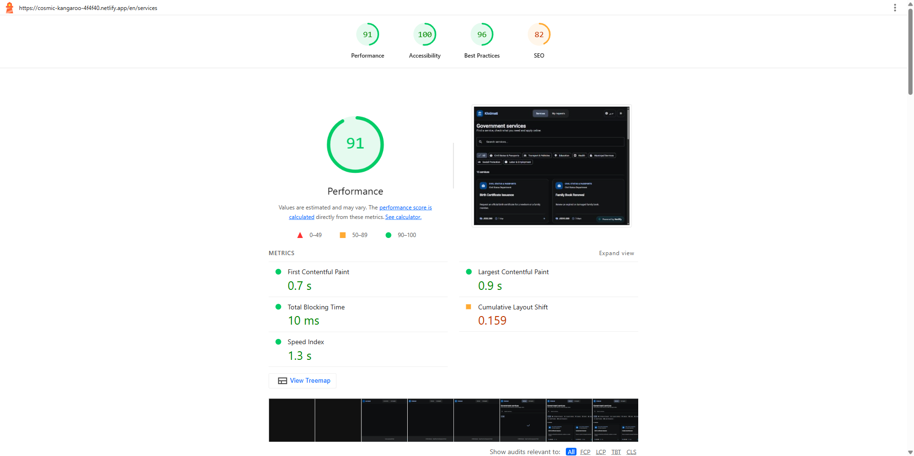
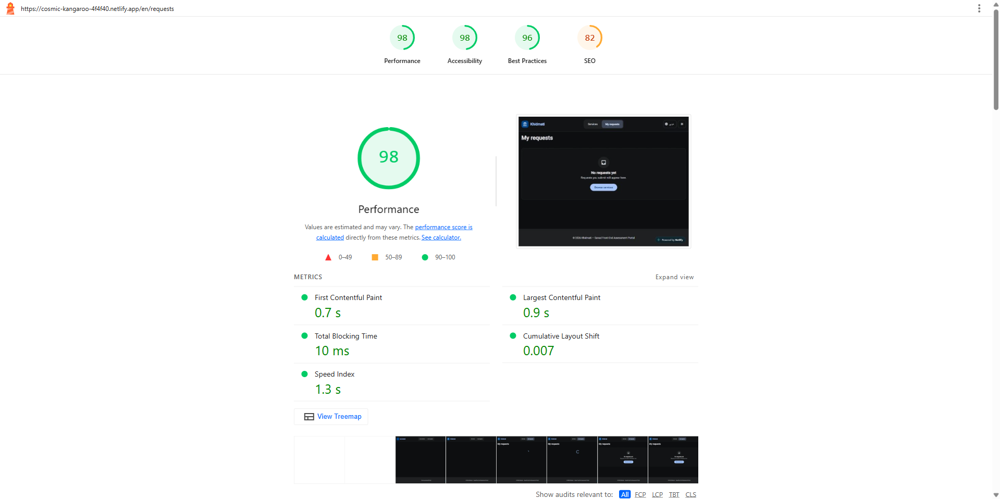
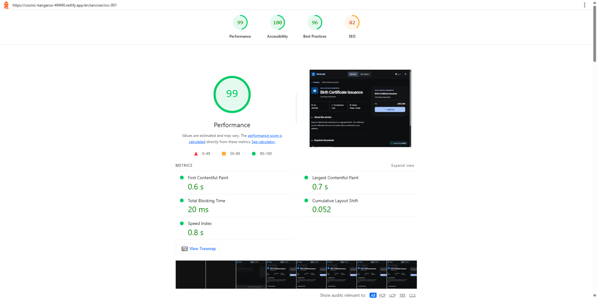
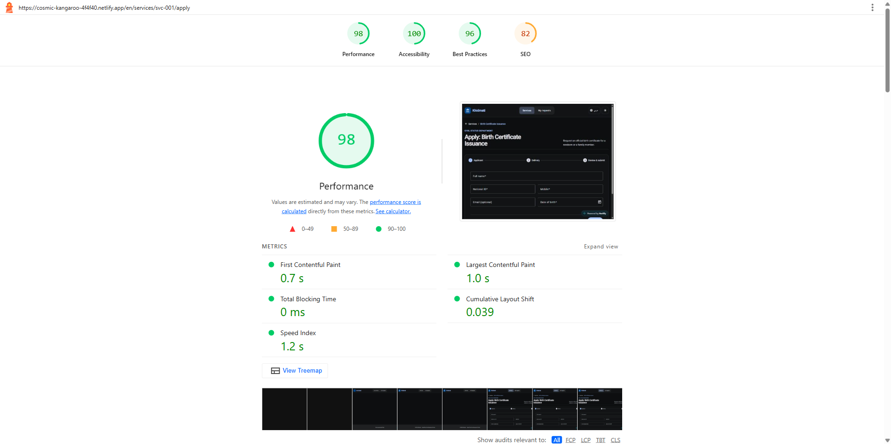

# Khidmati - Bilingual Government E-Services Portal

A bilingual (English / Arabic, RTL-correct) mini e-services portal built for the Sanad front-end assessment. Citizens browse government services, read the details, apply through a three-step form, and track or cancel their requests.

**Live demo:** https://khidmati-assessment.netlify.app/en/services


## Features

- **Service catalog** - browse services with search and category filters. Filters live in the URL (`?q=&category=`), so they survive refresh and can be shared.
- **Arabic-friendly search** - ignores diacritics and folds letter variants (alef, ya, ta marbuta).
- **Service details** - fee, processing time, required documents, and graceful handling of missing or odd data.
- **3-step apply form** - Reactive Forms with custom validators and a review step before submission.
- **My requests** - view and cancel submitted requests (stored in `localStorage`).
- **Full EN / AR support** - signal-based i18n, automatic `<html lang dir>`, and localized titles, dates, and currency (JOD).
- **Dark mode** - follows system preference, with a persisted manual toggle.
- **Unsaved-changes guard** - warns before leaving a half-filled application.
- **Accessible** - keyboard focus states and Lighthouse Accessibility of 98-100 on all pages.

## Tech stack

| Area      | Choice                                                                |
| --------- | --------------------------------------------------------------------- |
| Framework | Angular 22 (standalone components, signals, lazy routes)              |
| UI        | Angular Material + CDK                                                |
| Forms     | Reactive Forms                                                        |
| i18n      | Custom signal-based `I18nService` (no library)                        |
| State     | `signal()` / `computed()` in root services (no NgRx)                  |
| Tests     | Vitest + jsdom via `ng test`                                          |
| Hosting   | Netlify (SPA fallback in `netlify.toml`; `vercel.json` also included) |

No backend: `services.json` is served as a static asset from `public/data/`, and submitted requests are persisted in `localStorage`.

## Getting started

Requires Node 20+ and npm.

```bash
npm install      # install dependencies
npm start        # dev server at http://localhost:4200
npm test         # unit tests (Vitest)
npm run build    # production build -> dist/
```

No environment variables needed.

## Routes

| Path                        | Page            | Notes                                                                                               |
| --------------------------- | --------------- | --------------------------------------------------------------------------------------------------- |
| `/:lang/services`           | Catalog         | `lang` is `en` or `ar`; anything else redirects to `en`                                             |
| `/:lang/services/:id`       | Service details |                                                                                                     |
| `/:lang/services/:id/apply` | Apply form      | `activeServiceGuard` blocks inactive/unknown services; `pendingChangesGuard` protects unsaved input |
| `/:lang/requests`           | My requests     |                                                                                                     |
| `**`                        | Not found       | Localized 404                                                                                       |

All feature pages are lazy-loaded.

## Project structure

```
src/app/
  core/      singleton services, guards, interceptor, models, validators, utils
  layout/    app shell (header, nav, language switcher, theme toggle, footer)
  feature/   one folder per lazy-loaded screen (smart components)
  pattern/   reusable smart dialogs (confirm cancel, confirm leave)
  ui/        presentational components (service card, empty state)
public/
  data/      services.json
  i18n/      en.json, ar.json
docs/        Lighthouse screenshots
```

## Key decisions

- **`I18nService`** - signals for `currentLang`/`translations`, `computed()` for `dir`/`isRtl`, and an `effect()` syncing `<html lang>` and `<html dir>`. Translations are fetched once per language and cached, so switching back is instant. Chosen over a library to stay signal-native and avoid a runtime dependency for two JSON files.
- **State** - plain signals inside services. `ServicesDataService` exposes Map-backed lookups for O(1) access and shares one HTTP call via `shareReplay(1)`. For this scope a store library would be ceremony.
- **Guards** - `languageGuard` (validates `:lang`, redirects via `UrlTree`, keeps the rest of the path), `activeServiceGuard`, and `pendingChangesGuard` (delegates to a `canDeactivate()` the component implements).
- **`appHttpInterceptor`** - adds `Accept-Language`; on error shows a translated snackbar and re-throws, so the page still renders its own error/retry state.
- **`RequestsService`** - Observable API with simulated latency over `localStorage`. Swapping in a real API touches only this file.
- **Validators** - pure `ValidatorFn`s: national ID (10 digits), Jordanian mobile (`07[7-9]\d{7}`), minimum age 18, and appointment date (future, not Friday/Saturday).
- **`CustomTitleStrategy`** - localized `<title>` per route, including the service name on details/apply.

## Lighthouse (production)

| Page            | Perf | A11y | Best Practices | SEO | Report                                                     |
| --------------- | ---: | ---: | -------------: | --: | ---------------------------------------------------------- |
| Catalog         |   91 |  100 |             96 |  82 |  |
| My requests     |   98 |   98 |             96 |  82 |     |
| Service details |   99 |  100 |             96 |  82 |  |
| Apply form      |   98 |  100 |             96 |  82 |              |

## Bonus checklist

|   # | Bonus                                               | Status                           |
| --: | --------------------------------------------------- | -------------------------------- |
|   1 | Unit tests (validators, services, components)       | Done - 35 tests in 15 spec files |
|   2 | SSR with browser-only APIs handled                  | Not done - app is CSR only       |
|   3 | Signal Forms for the application form               | Not done - uses Reactive Forms   |
|   4 | Custom signal-based i18n service                    | Done                             |
|   5 | Dark mode (system preference, toggle, theme tokens) | Done                             |
|   6 | Lighthouse Accessibility >= 90 on catalog and apply | Done (100 / 100)                 |
|   7 | Search and filters synced to URL query params       | Done                             |
|   8 | Arabic-friendly search                              | Done                             |
|   9 | `canDeactivate` warning on half-filled form         | Done                             |
|  10 | Localized titles via custom `TitleStrategy`         | Done                             |

## Assumptions

- `services.json` is read-only; the UI handles its deliberate edge cases: missing `requiredDocuments`/`keywords`/`email`, `fee: 0` shown as "Free", `processingDays: 0` as "Same day", inactive services, empty categories, and very long names.
- Only `en` and `ar` are valid languages.
- Reference numbers (`KH-<year>-<6 random digits>`) are generated client-side with no uniqueness check, which is fine for this scope.

## Known limitations / next steps

- Add SSR and migrate the apply form to Signal Forms.
- Git history was split into small commits during final cleanup, so timestamps are close together.

## AI usage

ChatGPT was used for debugging build/test errors, writing and reviewing unit tests, refactor suggestions, explaining architecture and design patterns, and drafting the initial `en.json` / `ar.json` strings (reviewed and adjusted afterward).

**Example prompt:** "Give me hints about building the I18nService using signals - explain the behavior, the area of use, and which design pattern I may need."

**Where it was wrong:** for catalog search it suggested a dedicated injectable search service. That was over-engineering for simple string matching, so it was rewritten as plain functions in `core/utils/search-utils.ts`.
